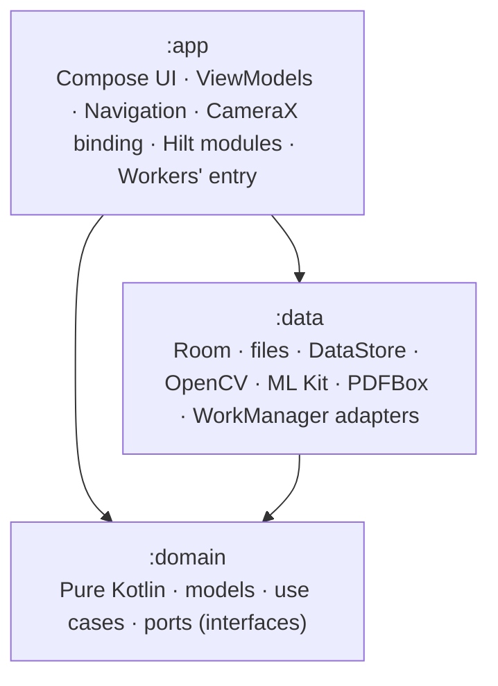

# 01 — Architecture

## 1. Modules and the dependency rule



| Module | Plugin | May depend on | Must never import |
|---|---|---|---|
| `:domain` | `kotlin("jvm")` | `kotlinx-coroutines-core`, `kotlinx-serialization-json`, `javax.inject` | `android.*`, `androidx.*`, `org.opencv.*`, `com.google.mlkit.*`, `com.tom_roush.*` |
| `:data` | `com.android.library` | `:domain`, Android/3rd-party libraries | `:app`, Compose |
| `:app` | `com.android.application` | `:domain`, `:data` | `org.opencv.*`, `com.tom_roush.*`, `androidx.room.*` (only Hilt modules in `:app/di` may reference `:data` implementation classes) |

**Why `:app` depends on `:data` at all:** Hilt must see implementations to bind them. That access is quarantined to `:app/di/*Module.kt`. ViewModels and composables only ever see `:domain` types. A Konsist/ArchUnit-style test enforces this (07 §5).

**Why `:domain` is a JVM module, not an Android library:** it makes "no Android imports" a compiler error, not a code-review comment, and its tests run in milliseconds on JUnit 5.

---

## 2. Package layout

Packages are organised **by feature first, then by layer role** inside each module. A developer adding "Recently Deleted" touches one folder per module, not ten.

```
:domain  com.avyaan.deckle.domain
├── common/          Outcome, DeckleError, Clock, IdGenerator, DispatcherProvider
├── geometry/        PointN, Quad, QuadRules, CornerOrdering, StabilityGate, Rotation
├── document/        Document, DocumentSummary, DocumentRepository, use cases (Create/Rename/Delete/Restore/Merge/Purge/Search)
├── page/            Page, PageRepository, OrderIndexAllocator, use cases (Reorder/Rotate/Delete/Insert/ReCrop/ReEnhance)
├── scan/            ScanSession, StagedCapture, ScanSessionStore, ProcessingQueue, CommitScanSessionUseCase
├── imaging/         ports: PageDetector, PerspectiveCorrector, PageEnhancer, ImageNormalizer, ThumbnailMaker; EnhancementMode, Adjustments
├── ocr/             OcrLine, TextRecognizer (port), OcrScheduler (port), RunOcrUseCase
├── export/          ExportRequest, PageSizePolicy, QualityPreset, PdfLayout (pure maths), PdfComposer (port), ExportScheduler (port), EstimateExportSizeUseCase
├── settings/        AppSettings, SettingsRepository (port)
└── storage/         StorageUsage, StorageInspector (port), ClearCacheUseCase, JanitorUseCase

:data  com.avyaan.deckle.data
├── db/              DeckleDatabase, entities, DAOs, migrations, mappers, RoomTransactionRunner
├── files/           FileLayout, AndroidPageFileStore, AtomicFile helpers, JsonScanSessionStore
├── settings/        DataStoreSettingsRepository
├── imaging/
│   ├── engine/      ImagingEngine (abstract factory), EngineSelector, OpenCvStatus
│   ├── opencv/      OpenCvPageDetector, OpenCvPerspectiveCorrector, OpenCvPageEnhancer, MatScope, filters/
│   ├── framework/   FrameworkPerspectiveCorrector, FrameworkPageEnhancer, NoOpPageDetector
│   └── common/      BitmapNormalizer (decode, downscale, EXIF), JpegWriter, ThumbnailMaker
├── ocr/             MlKitTextRecognizer (Latin), WorkManagerOcrScheduler, OcrWorker
└── export/          PdfBoxComposer, ImageFileExporter (SAF), WorkManagerExportScheduler, ExportWorker

:app  com.avyaan.deckle
├── DeckleApplication.kt, MainActivity.kt
├── di/              DomainModule, DataModule, ImagingModule, WorkModule, DispatchersModule
├── navigation/      Routes (type-safe @Serializable), DeckleNavHost, transitions
├── designsystem/    theme/ (Color, Type, Shape, Motion, Haptics), components/ (DeckleButton, ShutterButton, …)
├── feature/
│   ├── library/     LibraryRoute, LibraryScreen, LibraryViewModel, LibraryUiState, components/
│   ├── capture/     CaptureRoute, CaptureScreen, CaptureViewModel, camera/ (CameraController, DetectionAnalyzer), overlay/
│   ├── crop/        CornerEditor…
│   ├── review/      Review…
│   ├── document/    DocumentDetail…
│   ├── viewer/      PageViewer…
│   ├── export/      ExportSheet…
│   ├── trash/       RecentlyDeleted…
│   ├── settings/    Settings…, About…
│   └── permission/  CameraPermissionGate…
└── platform/        SecureWindow, ShareLauncher, NotificationChannels
```

---

## 3. SOLID — how each principle shows up concretely

| Principle | Concrete rule in this codebase | Example |
|---|---|---|
| **S** — Single responsibility | One use case = one class = one public `operator fun invoke`. One ViewModel per screen. Composables split into a stateful `XRoute` (wires VM) and stateless `XScreen(state, onEvent)` (draws). | `RotatePageUseCase` only rotates; it calls `PageEnhancer`, `ThumbnailMaker`, `PageRepository` but owns no I/O itself |
| **O** — Open/closed | New enhancement modes (and, in v2, OCR scripts and PDF fonts) are **added as new classes registered in a map**, never by editing a `when` in existing logic | Add "Magic colour" = new `EnhancementFilter` + one `@IntoMap` binding. No existing file changes except the enum and strings |
| **L** — Liskov substitution | Every port implementation honours the port's documented contract, including failure modes. The fallback engine and the no-op detector are *full* substitutes, not partial ones. | `NoOpPageDetector.detect()` returns `null` ("no page found") — a valid result the UI already handles — never throws `UnsupportedOperationException` |
| **I** — Interface segregation | Ports are narrow and role-named. No `ImageProcessor` god-interface. | `PageDetector`, `PerspectiveCorrector`, `PageEnhancer`, `ThumbnailMaker` are separate; the capture screen depends only on `PageDetector` |
| **D** — Dependency inversion | `:domain` owns every interface it needs; `:data` implements them. Use cases receive ports by constructor injection. | `CommitScanSessionUseCase(sessionStore: ScanSessionStore, pages: PageRepository, files: PageFileStore, tx: TransactionRunner, ocr: OcrScheduler)` — zero Android types |

---

## 4. Design patterns — used and rejected

The rule: a pattern is used only where it removes a concrete problem stated in the requirements. Each entry names that problem.

### 4.1 Used

| Pattern | Where | The concrete problem it solves | Why not something simpler |
|---|---|---|---|
| **Ports & Adapters (Hexagonal)** — Adapter | `:data` classes wrapping OpenCV, ML Kit, PDFBox, Room, WorkManager behind `:domain` interfaces | Requirements: "a page is a file path plus a corner quad, never a `Bitmap` or `Mat`"; domain must unit-test on the JVM | Calling libraries directly from use cases would leak native types upward and make the domain untestable |
| **Repository** | `DocumentRepository`, `PageRepository`, `SettingsRepository` | Documents span Room rows **and** a folder on disk (deleting one must delete both); callers shouldn't know there are two stores | A bare DAO exposes Room entities and can't coordinate file deletion |
| **Strategy** | `EnhancementFilter` (Original/Magic/Colour/Lighten/Photo/Greyscale/B&W/Ink saver) | FR-31 has eight interchangeable algorithms switched at runtime. Each must be independently testable against fixtures. | A `when(mode)` block inside one class grows with every mode, mixes four algorithms' native-memory handling in one function, and violates OCP |
| **Abstract Factory** | `ImagingEngine` with `OpenCvEngine` and `FrameworkEngine` | Degraded mode: if OpenCV fails to load, detector, warp and filters must **all** switch to non-OpenCV implementations together. Mixing (OpenCV filter + fallback detector) would call into an unloaded native library and crash. | Separate per-port factories could be configured inconsistently; one factory guarantees a consistent family, chosen once at startup |
| **Null Object** | `NoOpPageDetector` (inside `FrameworkEngine`) | Requirement: with OpenCV unavailable, "automatic detection disabled" and the UI continues. Null-object means `CaptureViewModel` has no `if (opencvAvailable)` branches. | Nullable detector forces null checks at every call site |
| **State Machine** (sealed classes + pure transition function) | `AutoCaptureMachine`, `OcrStatus`, export progress | FR-13 (0.8 s stable → fire; NV-14), FR-64/65 (queued → running → done/failed → retried once) have timing and retry rules that are easy to get subtly wrong with booleans | Booleans (`isStable`, `isCapturing`, `hasFired`) allow illegal combinations; a sealed state makes them unrepresentable and the transition function is a pure, table-testable function |
| **Producer–Consumer** (coroutine `Channel`) | `ProcessingQueue` for captured shots | FR-18: "capture must remain responsive while a previous page is still being processed; processing is queued". Also caps peak memory (only one full-res page in flight). | Launching a coroutine per shot runs N full-res warps concurrently → OOM on 6 GB devices during fast batch shooting |
| **Unidirectional Data Flow (MVI-style)** | Every ViewModel: `StateFlow<UiState>` out, `onEvent(UiEvent)` in, `Flow<UiEffect>` for one-shots | Process death + rotation restoration on every screen; Compose UI tests need a single, inspectable state | Ad-hoc mutable VM properties make restoration and testing piecemeal |
| **Unit of Work** (thin) | `TransactionRunner` port | Commit, merge and delete must update several tables atomically, and the domain can't import Room's `withTransaction` | Repositories each opening their own transaction can't compose |

### 4.2 Considered and deliberately not used

| Pattern | Why rejected |
|---|---|
| **Builder** for `ExportRequest`, `PdfLayout` etc. | Kotlin data classes with named, defaulted parameters already give readable construction with compile-time required fields |
| **Chain of Responsibility / Pipeline objects** for image steps | The pipeline is fixed and short (normalise → detect → warp → flatten → filter). A use case calling ports in sequence is more readable than a configurable chain nobody reconfigures |
| **Command (with undo stack)** for edits | No requirement for multi-step undo. Undo of delete is served by soft delete + snackbar. Adding a command bus would be speculative generality |
| **Base ViewModel class** | Inheritance couples every screen to one evolving base. The UDF contract is a three-member convention, enforced by review, not a superclass |
| **Event bus** | Flows from repositories already broadcast changes; a bus would add a second, untyped channel |
| **Strategy for OCR scripts / PDF fonts** | v1 is Latin-only (D-1): one recognizer, one font. A one-entry strategy map is indirection with no second implementation. Introduce it in v2 with Devanagari |
| **Service Locator** | Hilt constructor injection is used everywhere; no `get<T>()` lookups |
| **Singleton objects** for stateful services | Everything stateful is a Hilt `@Singleton`-scoped instance, replaceable in tests. `object` is only for stateless constants and pure functions |

---

## 5. Presentation: the UDF contract

Every screen follows exactly this shape. Readability comes from sameness.

```kotlin
// feature/document/DocumentDetailContract.kt
@Immutable
data class DocumentDetailUiState(
    val title: String = "",
    val isRenaming: Boolean = false,
    val pages: ImmutableList<PageTileUi> = persistentListOf(),
    val isLoading: Boolean = true,
)

sealed interface DocumentDetailEvent {
    data class Rename(val newTitle: String) : DocumentDetailEvent
    data class MovePage(val fromIndex: Int, val toIndex: Int) : DocumentDetailEvent
    data object CopyText : DocumentDetailEvent
    // …
}

sealed interface DocumentDetailEffect {
    data class ShowMessage(val message: UiText, val undo: DocumentDetailEvent? = null) : DocumentDetailEffect
    data class CopyToClipboard(val text: String) : DocumentDetailEffect
    data class OpenExport(val documentId: String, val pageIds: List<String>?) : DocumentDetailEffect
}
```

```kotlin
@HiltViewModel
class DocumentDetailViewModel @Inject constructor(
    savedState: SavedStateHandle,
    observeDocument: ObserveDocumentUseCase,
    private val renameDocument: RenameDocumentUseCase,
    private val reorderPage: ReorderPageUseCase,
    private val getDocumentText: GetDocumentTextUseCase,
) : ViewModel() {

    private val route = savedState.toRoute<DocumentRoute>()
    private val renaming = savedState.getMutableStateFlow("renaming", false)   // survives process death

    val state: StateFlow<DocumentDetailUiState> =
        combine(observeDocument(route.documentId), renaming, ::toUiState)
            .stateIn(viewModelScope, SharingStarted.WhileSubscribed(5_000), DocumentDetailUiState())

    private val _effects = Channel<DocumentDetailEffect>(Channel.BUFFERED)
    val effects: Flow<DocumentDetailEffect> = _effects.receiveAsFlow()

    fun onEvent(event: DocumentDetailEvent) { when (event) { /* one small private fun per event */ } }
}
```

```kotlin
@Composable
fun DocumentDetailRoute(onOpenPage: (String) -> Unit, vm: DocumentDetailViewModel = hiltViewModel()) {
    val state by vm.state.collectAsStateWithLifecycle()
    ObserveEffects(vm.effects) { effect -> /* snackbar, clipboard, navigation */ }
    DocumentDetailScreen(state = state, onEvent = vm::onEvent)
}

@Composable
fun DocumentDetailScreen(state: DocumentDetailUiState, onEvent: (DocumentDetailEvent) -> Unit) { /* pure drawing */ }
```

Rules:
- **Repositories are the source of truth**; UI state is *derived* via `combine`. VMs hold only ephemeral UI state (dialog open, slider drag value) and persist it in `SavedStateHandle` when losing it would annoy the user.
- **Effects** go through a `Channel` (delivered once). Never model one-shot events as state flags.
- UI models (`PageTileUi`) are built in the VM; composables never see domain entities. Lists use `kotlinx-collections-immutable` so Compose can skip recomposition.
- User-facing text from VMs is `UiText` (string resource id + args), never a raw `String` — keeps lint's `HardcodedText` meaningful and allows locale changes.

---

## 6. Activity, navigation, configuration

- **Single activity** `MainActivity : ComponentActivity`, `enableEdgeToEdge()`, `installSplashScreen()` (Core SplashScreen; splash holds until `StartupState` is ready — see 02 §6).
- **Navigation Compose with type-safe routes** (`@Serializable` objects/data classes). Routes carry IDs only, never objects.

```kotlin
@Serializable data object LibraryRoute
@Serializable data class CaptureRoute(val sessionId: String? = null, val targetDocumentId: String? = null, val insertAfterPageId: String? = null)
@Serializable data class CropRoute(val sessionId: String, val captureId: String)
@Serializable data class ReviewRoute(val sessionId: String, val captureId: String? = null)
@Serializable data class DocumentRoute(val documentId: String)
@Serializable data class PageViewerRoute(val documentId: String, val pageId: String)
@Serializable data class RecropRoute(val documentId: String, val pageId: String)
@Serializable data object TrashRoute
@Serializable data object SettingsRoute
@Serializable data object AboutRoute
```

The export UI is a `ModalBottomSheet` hosted by the document/library screens, not a route — it is transient and doesn't need deep-link or back-stack identity.

- **Shared element transitions** wrap the whole `NavHost` in a `SharedTransitionLayout`; `SharedTransitionScope` and each destination's `AnimatedVisibilityScope` are passed down via `CompositionLocal`s (`LocalSharedTransitionScope`, `LocalNavAnimatedScope`) so leaf composables can opt in with `Modifier.sharedElement(...)` without parameter drilling.
- **Configuration changes (D-6):** `MainActivity` declares `android:configChanges="orientation|screenSize|screenLayout|smallestScreenSize|keyboardHidden"`. Compose recomposes for the new size; the camera stays bound; the detection overlay and stability history are untouched. Theme/locale/font-scale changes still recreate the activity, so **every screen must still restore from `SavedStateHandle`** — verified by the "Don't keep activities" test suite (07 §6).

---

## 7. Concurrency model

| Work | Dispatcher | Bound |
|---|---|---|
| UI state, VM logic | `Main.immediate` | — |
| Live detection (480 px frames) | CameraX analyzer executor (single background thread) | `STRATEGY_KEEP_ONLY_LATEST` — drops frames instead of queueing |
| Full-res imaging (normalise, warp, enhance) | `@ImagingDispatcher` = `Dispatchers.Default.limitedParallelism(1)` | **One** full-res page in memory at a time → keeps 50-page peak heap under 400 MB |
| Preview-res enhancement (review screen) | `@PreviewDispatcher` = `Dispatchers.Default.limitedParallelism(2)` | Small images; two so the filter-strip previews render in parallel |
| DB, file I/O | `Dispatchers.IO` | — |
| OCR, export | WorkManager workers (`CoroutineWorker`) which then use the dispatchers above | WorkManager's executor |

Dispatchers are injected (`DispatcherProvider` in domain; qualifiers in `:app/di`), never referenced statically in production code — tests substitute `StandardTestDispatcher`.

**Cancellation:** every long operation is `suspend`, calls `ensureActive()` between pipeline stages (and between PDF pages), and reports progress via `Flow<Progress>` or `ProgressListener` lambda. Native resources are released in `finally` so cancellation never leaks a `Mat`.

---

## 8. Error handling

```kotlin
// :domain/common
sealed interface Outcome<out T> {
    data class Success<T>(val value: T) : Outcome<T>
    data class Failure(val error: DeckleError) : Outcome<Nothing>
}

sealed interface DeckleError {
    data object StorageFull : DeckleError
    data class FileMissing(val path: String) : DeckleError
    data object ImageDecodeFailed : DeckleError
    data object ImagingUnavailable : DeckleError          // engine can't do this op (e.g. B&W in fallback is fine, but re-detect isn't)
    data class OcrFailed(val cause: String) : DeckleError
    data class ExportFailed(val cause: String) : DeckleError
    data object Cancelled : DeckleError
    data class Unexpected(val cause: Throwable) : DeckleError
}
```

- **Why a custom `Outcome` instead of `kotlin.Result`:** `Result` carries an untyped `Throwable`, so the UI would have to `instanceof`-sniff exceptions to choose a message. Typed errors map 1:1 to user messages in one `DeckleError.toUiText()` function.
- **Adapters convert exceptions at the boundary.** `:data` catches library exceptions (`CvException`, `MlKitException`, `IOException`, PDFBox `IOException`) and returns `Outcome.Failure`. `CancellationException` is **always rethrown**, never wrapped.
- **Programming errors still throw.** `require`/`check` for violated invariants (e.g. a `Quad` with 3 points). Only *expected* runtime failures become `Outcome`.
- **No silent failures.** Every `Failure` reaching a VM produces either a snackbar, an inline state (e.g. OCR "failed" badge), or a logged-and-recovered path in the janitor. Logging is `Log` via a tiny `Logger` port, release builds strip `d`/`v` via R8 `-assumenosideeffects`. **Nothing is ever sent anywhere.**

---

## 9. Dependency injection

Hilt, constructor injection only.

| Module (in `:app/di`) | Binds |
|---|---|
| `DispatchersModule` | `DispatcherProvider`, `@ImagingDispatcher`, `@PreviewDispatcher`, `@ApplicationScope CoroutineScope` |
| `DatabaseModule` | `DeckleDatabase` (Room builder with migrations, **no** `fallbackToDestructiveMigration`), DAOs, `TransactionRunner` |
| `RepositoryModule` | `DocumentRepository`, `PageRepository`, `SettingsRepository`, `ScanSessionStore`, `PageFileStore`, `StorageInspector` |
| `ImagingModule` | `ImagingEngine` (provided by `EngineSelector` from `OpenCvStatus`), then `PageDetector`, `PerspectiveCorrector`, `PageEnhancer` **derived from the engine** — consumers inject the narrow ports, never the engine |
| `OcrModule` | `TextRecognizer` (-> `MlKitTextRecognizer`), `OcrScheduler` |
| `ExportModule` | `PdfComposer`, `ExportScheduler`, `ImageFileExporter` |
| `WorkModule` | `HiltWorkerFactory` via `Configuration.Provider` on `DeckleApplication` |

Use cases need no module: they have `@Inject constructor`s and depend only on ports.

---

## 10. Readability conventions

- Files ≤ ~300 lines; functions ≤ ~40 lines. A function that needs a comment to explain *what* it does should be split and named instead; comments explain *why* (and cite the FR number when a magic number comes from the requirements: `// FR-13: 1.2 s`).
- **Requirement numbers are constants**, named and grouped, never inline literals:

```kotlin
object DetectionTuning {               // :domain/geometry
    const val MIN_AREA_FRACTION = 0.20f        // requirements: reject quads < 20 % of frame
    const val MAX_OPPOSITE_SIDE_RATIO = 4f     // requirements: reject > 4:1
    const val APPROX_EPSILON_FRACTION = 0.02   // 2 % of arc length
    const val STABILITY_WINDOW = 5
    const val STABILITY_TOLERANCE = 0.02f      // 2 % of frame width
    const val AUTO_CAPTURE_HOLD_MS = 1_200L    // FR-13
    const val ANALYSIS_LONG_EDGE_PX = 480
}
```

- Naming: use cases are verb phrases (`MergeDocumentsUseCase`), ports are role nouns (`PageDetector`), adapters are `<Tech><Port>` (`OpenCvPageDetector`, `RoomDocumentRepository`).
- No `!!`. No `lateinit` outside DI-injected Android framework classes. No `GlobalScope`.
- Explicit API mode (`kotlin { explicitApi() }`) in `:domain` so the public surface is deliberate.
