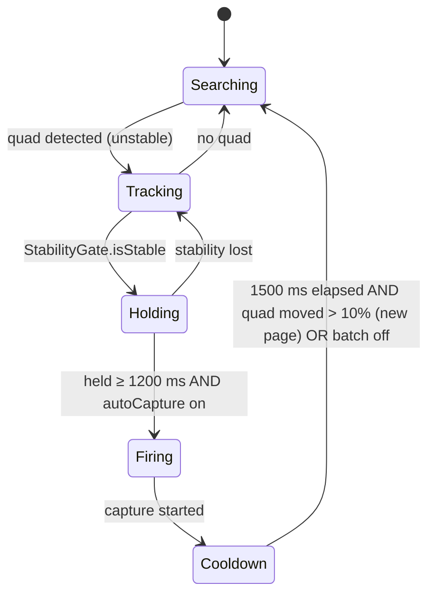

# 02 — Domain Model and Data Layer

## 1. Domain models (`:domain`)

All domain models are immutable `data class`es with no Android types. Geometry is **normalised** (0–1) so it survives downscaling, rotation and re-export.

```kotlin
// geometry/
@Serializable data class PointN(val x: Float, val y: Float)            // normalised 0..1

@Serializable data class Quad(val tl: PointN, val tr: PointN, val br: PointN, val bl: PointN) {
    val corners: List<PointN> get() = listOf(tl, tr, br, bl)
    companion object {
        val FULL = Quad(PointN(0f, 0f), PointN(1f, 0f), PointN(1f, 1f), PointN(0f, 1f))
    }
}

enum class Rotation(val degrees: Int) { R0(0), R90(90), R180(180), R270(270);
    fun clockwise() = entries[(ordinal + 1) % 4]
    fun counterClockwise() = entries[(ordinal + 3) % 4]
}

// imaging/
enum class EnhancementMode { ORIGINAL, MAGIC, COLOUR, LIGHTEN, PHOTO, GREYSCALE, BLACK_AND_WHITE, ECO }   // persisted by name; strip order
@Serializable data class Adjustments(val brightness: Float = 0f, val contrast: Float = 0f) // each in [-1, 1]; 0 = neutral

// document/ & page/
data class Document(
    val id: String, val title: String,
    val createdAt: Instant, val modifiedAt: Instant,
    val coverPageId: String?, val deletedAt: Instant?,
)

data class DocumentSummary(            // what the library grid shows
    val id: String, val title: String, val pageCount: Int,
    val createdAt: Instant, val modifiedAt: Instant,
    val coverThumbPath: String?, val matchSnippet: Snippet? = null,
)

data class Snippet(val text: String, val highlights: List<IntRange>)

data class Page(
    val id: String, val documentId: String, val orderIndex: Long,
    val sourcePath: String?, val basePath: String, val processedPath: String, val thumbPath: String,
    val corners: Quad, val rotation: Rotation,
    val mode: EnhancementMode, val adjustments: Adjustments,
    val widthPx: Int, val heightPx: Int,
    val ocr: OcrState,
)

// ocr/
enum class OcrStatus { QUEUED, RUNNING, DONE, FAILED }
@Serializable data class OcrLine(val text: String, val box: RectN, val confidence: Float)
@Serializable data class RectN(val left: Float, val top: Float, val right: Float, val bottom: Float)
data class OcrState(val status: OcrStatus, val lines: List<OcrLine>?, val attempts: Int)
```

`Instant` is `kotlinx.datetime.Instant` (or `java.time.Instant`; both are JVM-pure — pick `java.time` to avoid a dependency, since minSdk 26 has it natively).

### 1.1 Pure domain logic (all JVM-unit-tested)

| Class | Responsibility | Key rules |
|---|---|---|
| `CornerOrdering` | Order 4 unordered points into TL, TR, BR, BL | TL = min(x+y), BR = max(x+y), TR = max(x−y), BL = min(x−y). If two roles resolve to the same point (degenerate, e.g. a diamond at 45°), fall back to angular sort around the centroid starting from the point with the smallest angle from −135°. Test both paths. |
| `QuadRules` | Validate a candidate quad | area ≥ 20 % of frame; each pair of opposite sides ratio ≤ 4:1; convex; non-self-intersecting. Pure maths on `PointN`; `:data` calls this for each contour candidate. |
| `QuadGeometry` | Area (shoelace), side lengths, convexity (cross-product sign consistency), `outputSize(quad, imgW, imgH)` = `max(‖TR−TL‖,‖BR−BL‖)` × `max(‖BL−TL‖,‖BR−TR‖)` in pixels | |
| `StabilityGate` | Holds last 5 quads; `isStable` when every corner moved < 2 % of frame width (x-normalised distance, aspect-corrected) across all 5 | Any `null` detection clears the window |
| `AutoCaptureMachine` | State machine for FR-13 (see §1.2) | Clock injected |
| `OrderIndexAllocator` | Sparse ordering stepped by 1000 | Insert between a and b → `(a+b)/2`; append → `last + 1000`; if gap < 2 → returns `Renumber` instruction (rewrite all to 1000·i in one transaction) |
| `QuadRotation` | Rotate a normalised quad/rect by 90° steps | (x,y) → CW: (1−y, x); CCW: (y, 1−x); 180: (1−x, 1−y). Used to rotate OCR boxes on page rotate without re-OCR |
| `CropConstraint` | Clamp a dragged corner to [0,1] and reject a move that makes the quad non-convex | Returns the last valid position + `rejected = true` so the UI can shake |
| `DefaultTitle` | `Scan yyyy-MM-dd HH:mm` from injected `Clock` + `ZoneId` | FR-43 |
| `PdfLayout` | Page size + image rect + per-line text placement maths | See 04 §3 |
| `SearchQuery` | Sanitize user text into an FTS4 MATCH expression | Split on whitespace, strip `"*():^-` and FTS keywords (`AND OR NOT NEAR`), quote each token, add `*` prefix wildcard: `hello wor` → `"hello*" "wor*"` (FTS4 needs the star inside the quotes). Empty → null (title-only search) |

### 1.2 Auto-capture state machine (FR-13)



```kotlin
sealed interface AutoCaptureState {
    data object Searching : AutoCaptureState
    data class Tracking(val quad: Quad) : AutoCaptureState
    data class Holding(val quad: Quad, val since: Long) : AutoCaptureState { fun progress(now: Long) = ((now - since) / 1200f).coerceIn(0f, 1f) }
    data class Firing(val quad: Quad) : AutoCaptureState
    data class Cooldown(val lastQuad: Quad, val since: Long) : AutoCaptureState
}

fun AutoCaptureState.next(input: DetectionInput, now: Long, autoEnabled: Boolean): AutoCaptureState
```

The **Cooldown** state is a UX addition: after an auto-capture in batch mode, it waits until the user has turned the page (quad moved > 10 % or disappeared and reappeared) so the same page isn't captured twice. `Holding.progress` drives the ring around the shutter (05 §4).

---

## 2. Ports (`:domain` interfaces implemented in `:data`)

```kotlin
interface DocumentRepository {
    fun observeLibrary(sort: SortOrder): Flow<List<DocumentSummary>>
    fun search(query: String, sort: SortOrder): Flow<List<DocumentSummary>>   // FR-3: title OR OCR text
    fun observeDocument(id: String): Flow<Document?>
    fun observeTrash(): Flow<List<DocumentSummary>>
    suspend fun create(title: String): Document
    suspend fun rename(id: String, title: String)
    suspend fun softDelete(ids: List<String>, at: Instant)
    suspend fun restore(ids: List<String>)
    suspend fun hardDelete(ids: List<String>)                // rows + folders, see §4.3
    suspend fun idsDeletedBefore(cutoff: Instant): List<String>
    suspend fun touch(id: String, at: Instant)               // modifiedAt
}

interface PageRepository {
    fun observePages(documentId: String): Flow<List<Page>>
    suspend fun get(pageId: String): Page?
    suspend fun insert(pages: List<Page>)
    suspend fun update(page: Page)
    suspend fun updateOrder(pageId: String, orderIndex: Long)
    suspend fun renumber(documentId: String)
    suspend fun delete(pageId: String)
    suspend fun setOcr(pageId: String, state: OcrState, plainText: String?)
    suspend fun pagesWithOcrStatus(status: OcrStatus, maxAttempts: Int): List<Page>
    suspend fun documentText(documentId: String): String     // FR-45, pages in order, separated by "\n\n"
}

interface TransactionRunner { suspend fun <T> inTransaction(block: suspend () -> T): T }

interface PageFileStore {                     // all paths are absolute strings
    fun documentDir(documentId: String): String
    fun pathFor(documentId: String, pageId: String, kind: PageFileKind): String   // SOURCE, BASE, PROCESSED, THUMB
    suspend fun moveIntoDocument(stagedPath: String, documentId: String, pageId: String, kind: PageFileKind): String
    suspend fun deletePageFiles(page: Page)
    suspend fun tombstoneDocumentDir(documentId: String): Tombstone   // rename → ".<id>.deleting"
    suspend fun commitTombstone(t: Tombstone)                          // delete recursively
    suspend fun revertTombstone(t: Tombstone)                          // rename back
}

interface SettingsRepository {
    val settings: Flow<AppSettings>
    suspend fun update(transform: (AppSettings) -> AppSettings)
}

interface Clock { fun now(): Instant }
interface IdGenerator { fun newId(): String }   // UUID v4 string
```

Imaging, OCR and export ports are defined in documents 03 and 04.

---

## 3. Room schema (v1)

`DeckleDatabase`, `version = 1`, `exportSchema = true`, schema JSON committed under `data/schemas/`. **`fallbackToDestructiveMigration` must not appear anywhere** — a CI grep enforces it (07 §4).

### 3.1 `documents`

As specified in the requirements, unchanged.

```kotlin
@Entity(tableName = "documents", indices = [Index("deletedAt"), Index("modifiedAt"), Index("createdAt")])
data class DocumentEntity(
    @PrimaryKey val id: String,
    val title: String,
    val createdAt: Long,
    val modifiedAt: Long,
    val coverPageId: String?,
    val deletedAt: Long?,
)
```

### 3.2 `pages`

Requirements' columns plus **three additions (D-2, D-3)**: `basePath`, `brightness`, `contrast`, and one bookkeeping column `ocrAttempts` (FR-65 "retried once" needs a counter).

```kotlin
@Entity(
    tableName = "pages",
    foreignKeys = [ForeignKey(DocumentEntity::class, ["id"], ["documentId"], onDelete = ForeignKey.CASCADE)],
    indices = [Index("documentId"), Index("ocrStatus")],
)
data class PageEntity(
    @PrimaryKey val id: String,
    val documentId: String,
    val orderIndex: Long,
    val sourcePath: String?,
    val basePath: String,            // ADDED: dewarped, un-enhanced
    val processedPath: String,
    val thumbPath: String,
    val cornersJson: String,         // Quad, normalised against the *source*
    val enhancementMode: String,
    val rotationDegrees: Int,
    val brightness: Float,           // ADDED
    val contrast: Float,             // ADDED
    val widthPx: Int, val heightPx: Int,
    val ocrStatus: String,
    val ocrAttempts: Int,            // ADDED
    val ocrLinesJson: String?,
    val ocrPlainText: String?,
)
```

- Since v1 is the first shipped schema, these additions cost no migration.
- JSON columns use `kotlinx.serialization` via `@TypeConverter`s on the *mapper*, not on the entity (entities stay plain strings; mapping is explicit and testable).
- Enum columns store `name`; the mapper falls back to a safe default (`ORIGINAL`, `QUEUED`) on an unknown name rather than crashing, so a future enum rename can't brick the library.

### 3.3 `pages_fts`

```kotlin
@Fts4(contentEntity = PageEntity::class)
@Entity(tableName = "pages_fts")
data class PageFtsEntity(val ocrPlainText: String?)
```

Room generates sync triggers for external-content FTS. Join on `pages.rowid = pages_fts.rowid`.

> ⚠️ `pages` has a TEXT primary key, so its `rowid` is implicit and **may be renumbered by `VACUUM`**, silently breaking the FTS mapping. Never run `VACUUM`. If a future migration must, follow it with `INSERT INTO pages_fts(pages_fts) VALUES('rebuild')`. Leave this as a comment on the entity.

### 3.4 Key queries

```sql
-- Library (FR-1, FR-2): one row per live document with cover thumb + page count
SELECT d.id, d.title, d.createdAt, d.modifiedAt,
       (SELECT COUNT(*) FROM pages p WHERE p.documentId = d.id) AS pageCount,
       COALESCE(
         (SELECT thumbPath FROM pages WHERE id = d.coverPageId),
         (SELECT thumbPath FROM pages WHERE documentId = d.id ORDER BY orderIndex LIMIT 1)
       ) AS coverThumbPath
FROM documents d
WHERE d.deletedAt IS NULL
ORDER BY  -- three @Query variants, one per SortOrder; Room can't bind ORDER BY columns
```

```sql
-- Search (FR-3): title match UNION OCR match, with snippet
SELECT d.id, …, NULL AS snippet, 0 AS rank FROM documents d
 WHERE d.deletedAt IS NULL AND d.title LIKE '%' || :titleLike || '%' ESCAPE '\'
UNION ALL
SELECT d.id, …, snippet(pages_fts, '\u0002', '\u0003', '…', -1, 10) AS snippet, 1 AS rank
  FROM pages_fts JOIN pages p ON p.rowid = pages_fts.rowid JOIN documents d ON d.id = p.documentId
 WHERE d.deletedAt IS NULL AND pages_fts MATCH :ftsQuery
```

The repository de-duplicates by document id (title hit wins; otherwise first page hit), then parses `\u0002…\u0003` markers into `Snippet.highlights`. Control characters are used as markers because they cannot appear in OCR text.

---

## 4. Files on disk

### 4.1 Layout

```
files/docs/<documentId>/source/<pageId>.jpg      only if "save originals" is on
files/docs/<documentId>/base/<pageId>.jpg        ADDED (D-2), JPEG q=95
files/docs/<documentId>/pages/<pageId>.jpg       processed, JPEG q=90
files/docs/<documentId>/thumbs/<pageId>.jpg      320 px long edge, q=80
files/staging/<sessionId>/session.json           ADDED (D-4)
files/staging/<sessionId>/<captureId>.{source,base,processed,preview}.jpg
files/.<documentId>.deleting/                    transient tombstone
cache/exports/<exportId>.pdf | .zip-less folder of images
cache/preview/                                   review-screen downscaled working copies
cache/coil/                                      thumbnail disk cache
```

`FileLayout` is the only class that builds these paths. Everything else asks it.

### 4.2 Atomic writes

Every file write goes to `<name>.tmp` then `renameTo(<name>)` (atomic on the same filesystem). A crash mid-write leaves a `.tmp` that the janitor deletes; it never leaves a truncated JPEG a row points to.

### 4.3 Deleting a document "in the same transaction"

Files can't join a SQLite transaction, so deletion uses a **tombstone protocol** that is crash-safe at every step:

```
1. rename  files/docs/<id>  →  files/.<id>.deleting        (atomic)
2. DB transaction: DELETE FROM documents WHERE id = :id     (pages cascade)
3a. success → delete files/.<id>.deleting recursively
3b. failure → rename back, rethrow as Outcome.Failure
On launch: the janitor deletes any .*.deleting dir whose document row no longer exists,
           and renames back any whose row still exists (crash between 1 and 2).
```

This satisfies the acceptance criterion "deleting a document removes both its rows and its folder; no orphaned files remain".

---

## 5. Scan sessions (staging, D-4)

An in-progress scan must survive process death or fail cleanly. It lives entirely in `files/staging/<sessionId>/` until committed.

```kotlin
@Serializable data class ScanSession(
    val id: String,
    val createdAt: Long,
    val targetDocumentId: String?,        // null = new document; set when "Add page" from a document
    val insertAfterPageId: String?,       // FR-42 "insert a new page after"
    val captures: List<StagedCapture>,
)

@Serializable data class StagedCapture(
    val id: String,
    val sourcePath: String,
    val previewPath: String,              // ≤1600 px, for the crop and review screens
    val detectedQuad: Quad?,              // what the detector found (null = none)
    val quad: Quad,                       // what the user accepted (defaults to detectedQuad ?: Quad.FULL)
    val rotation: Rotation,
    val mode: EnhancementMode,
    val adjustments: Adjustments,
    val basePath: String?,                // null until processed
    val processedPath: String?,
    val status: StagedStatus,             // CAPTURED → PROCESSING → READY | FAILED
)

interface ScanSessionStore {
    fun observe(sessionId: String): Flow<ScanSession?>
    suspend fun create(target: String?, insertAfter: String?): ScanSession
    suspend fun update(sessionId: String, transform: (ScanSession) -> ScanSession)   // serialised by a Mutex per session
    suspend fun discard(sessionId: String)                                            // delete folder
    suspend fun listAll(): List<ScanSession>
}
```

`JsonScanSessionStore` keeps an in-memory `MutableStateFlow` per open session and writes `session.json` atomically (§4.2) after every `update`. Updates are serialised with a per-session `Mutex` because the processing queue and the UI both mutate captures.

### 5.1 Commit (`CommitScanSessionUseCase`)

```
precondition: every capture is READY (UI disables "Done" otherwise, showing a progress chip)
1. documentId = session.targetDocumentId ?: documents.create(DefaultTitle(now))
2. allocate orderIndex for each capture (append, or between insertAfter and its successor)
3. for each capture: move base/processed (+ source if saveOriginals) into files/docs/<doc>/…, make thumb
4. TransactionRunner { pages.insert(all); documents.touch(documentId) }
5. ocrScheduler.enqueue(pageIds)                  (FR-64)
6. sessionStore.discard(session.id)
7. return documentId
```

If step 4 fails, files moved in step 3 are moved back to staging (the use case keeps a list of moves and reverses them). If the process dies between 3 and 4, the janitor sees staged captures whose files are missing and page rows that don't exist; it deletes the orphaned files in `files/docs/<doc>/` that no row references (§6).

### 5.2 Abandoning

- Back/close from capture with captures present → confirmation dialog "Discard N scans?" → `discard`.
- On launch, sessions older than 24 h are discarded by the janitor. Sessions younger than that are **resumable**: the library shows a "Continue scanning (N pages)" banner (06 §1). This is how a process-death mid-scan "survives".

---

## 6. Startup and janitor

`DeckleApplication.onCreate` (in order, per requirements):

```
1. OpenCvStatus.init()        → OpenCVLoader.initLocal(); catch Throwable; record AVAILABLE | UNAVAILABLE(reason)
2. PDFBoxResourceLoader.init(applicationContext)
3. applicationScope.launch(IO) { startupTasks.run() }   // non-blocking
```

`StartupTasks` (domain use case `RunStartupMaintenanceUseCase`):

1. **Purge trash** (FR-7): `hardDelete(idsDeletedBefore(now − 30 days))`.
2. **Retry failed OCR once** (FR-65): pages with `FAILED` and `ocrAttempts < 2` → re-enqueue.
3. **Re-enqueue stranded OCR**: pages `QUEUED`/`RUNNING` with no active WorkManager work (the unique work name is deterministic, so enqueue with `KEEP` is idempotent).
4. **Janitor**: resolve tombstones (§4.3); delete `.tmp` files; delete page files with no row; discard staging sessions > 24 h; clear `cache/exports` files > 24 h.

The splash screen does **not** wait for these. It waits only for the first emission of settings (theme/secure flag) — typically < 50 ms.

---

## 7. Settings (DataStore Preferences)

```kotlin
data class AppSettings(
    val sortOrder: SortOrder = SortOrder.CREATED_DESC,          // FR-2
    val defaultMode: EnhancementMode = EnhancementMode.COLOUR,  // FR-70
    val defaultQuality: QualityPreset = QualityPreset.MEDIUM,
    val defaultPageSize: PageSizePolicy = PageSizePolicy.Auto,
    val autoCapture: Boolean = false,                           // FR-13, off by default
    val flash: FlashMode = FlashMode.AUTO,                      // FR-11
    val batchMode: Boolean = false,
    val saveOriginals: Boolean = true,                          // FR-71
    val secureScreens: Boolean = true,                          // FR-80, default on
    val hasSeenCaptureTips: Boolean = false,                    // first-run coach marks
)
```

`DataStoreSettingsRepository` maps keys ↔ fields in one place with defaults applied on read, so adding a setting is one field + one key. Unknown enum names fall back to defaults.
