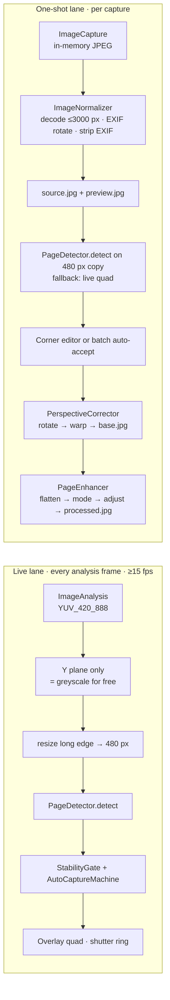

# 03 — Imaging Pipeline

## 1. Overview: two lanes



The live lane never touches full-resolution pixels. The still lane never runs at preview rate.

---

## 2. Camera setup (CameraX, `:app/feature/capture/camera`)

`CameraController` (our class, not `androidx.camera.view.CameraController`) owns binding. One `UseCaseGroup` with a shared **`ViewPort`** so Preview, ImageAnalysis and ImageCapture all see the **same field of view** — this is what makes a live quad valid as a fallback for the still.

| Use case | Configuration |
|---|---|
| `Preview` | `ResolutionSelector` with `AspectRatioStrategy.RATIO_4_3_FALLBACK_AUTO_STRATEGY`; `PreviewView.ScaleType.FILL_CENTER`; `ImplementationMode.COMPATIBLE` (needed for smooth shared-element snapshot and rotation animation) |
| `ImageAnalysis` | `RATIO_4_3`, target ~640×480; `OUTPUT_IMAGE_FORMAT_YUV_420_888`; `STRATEGY_KEEP_ONLY_LATEST`; dedicated single-thread executor |
| `ImageCapture` | `CAPTURE_MODE_MINIMIZE_LATENCY`; `RATIO_4_3`; `ResolutionSelector` capped at ~4000×3000 (no point capturing 108 MP to downscale to 3000); flash mode from settings |

- **Rotation (FR-16):** an `OrientationEventListener` updates `targetRotation` on ImageAnalysis and ImageCapture. The activity is not recreated (01 §6, D-6), so the bound camera, the `StabilityGate` window and the overlay persist through rotation.
- **Tap-to-focus (FR-14):** `previewView.meteringPointFactory.createPoint(x, y)` → `FocusMeteringAction` (AF+AE, auto-cancel 3 s). UI shows the focus ring (05 §4).
- **Pinch-to-zoom:** `cameraControl.setZoomRatio` clamped to `zoomState.min..max`; a zoom pill (`1.0×`) fades in while pinching and fades out 1 s after.
- **Flash (FR-11):** off / on / auto → `ImageCapture.FLASH_MODE_*`; persisted. For torch-style preview lighting, not in v1.
- **Lifecycle:** bind in `LifecycleStartEffect`, unbind on stop. Permission denied → the camera is never bound; the rationale screen shows instead (FR-17).

### 2.1 The analyzer

```kotlin
class DetectionAnalyzer(
    private val detector: PageDetector,
    private val onResult: (DetectionResult) -> Unit,
) : ImageAnalysis.Analyzer {
    override fun analyze(image: ImageProxy) = image.use {
        val y = image.planes[0]
        val frame = LumaFrame(y.buffer, image.width, image.height, y.rowStride, image.imageInfo.rotationDegrees)
        onResult(DetectionResult(detector.detect(frame), frameTimestampNs = image.imageInfo.timestamp))
    }
}
```

`LumaFrame` is a domain type wrapping a `java.nio.ByteBuffer` (JVM, not Android), so the port stays pure. The detector returns a quad **normalised in the upright (display-rotated) frame**, so the overlay just maps 0..1 to the preview's visible rect.

### 2.2 Overlay coordinate mapping

`PreviewView` with `FILL_CENTER` crops the 4:3 stream to the view. Mapping a normalised point to view pixels:

```
scale = max(viewW / imgW, viewH / imgH)          // imgW/H = upright analysis size
offX = (viewW − imgW·scale) / 2;  offY = (viewH − imgH·scale) / 2
viewX = offX + x·imgW·scale;      viewY = offY + y·imgH·scale
```

Pure function `PreviewMapping` in `:app`, unit-tested with rotated and cropped cases.

---

## 3. Ports

```kotlin
interface PageDetector {
    /** Live lane: luminance frame of any size. Returns null when no qualifying page. Must not throw. */
    fun detect(frame: LumaFrame): Quad?
    /** Still lane: decodes a downscaled copy internally. */
    suspend fun detect(imagePath: String): Quad?
    val isAvailable: Boolean          // false for NoOpPageDetector → UI shows "auto-detect off" explainer
}

interface ImageNormalizer {
    /** Decode (JPEG bytes or content Uri), apply EXIF orientation, downscale long edge ≤ 3000, write without EXIF. */
    suspend fun normalize(input: ImageInput, sourceOut: String, previewOut: String, previewLongEdge: Int = 1600): Outcome<ImageSize>
}

interface PerspectiveCorrector {
    suspend fun correct(sourcePath: String, quad: Quad, rotation: Rotation, out: String): Outcome<ImageSize>
}

interface PageEnhancer {
    val supportedModes: Set<EnhancementMode>
    /** Full resolution, writes processed JPEG. */
    suspend fun enhance(basePath: String, mode: EnhancementMode, adj: Adjustments, out: String): Outcome<ImageSize>
    /** Downscaled preview for FR-32; returns an encoded JPEG path in cache/preview. */
    suspend fun preview(basePath: String, mode: EnhancementMode, adj: Adjustments, longEdge: Int): Outcome<String>
    /** FR-60: shadow-flattened greyscale for OCR. */
    suspend fun ocrInput(basePath: String, out: String): Outcome<ImageSize>
}

interface ThumbnailMaker { suspend fun make(processedPath: String, out: String, longEdge: Int = 320): Outcome<Unit> }
```

---

## 4. Quad detection (`OpenCvPageDetector`)

Exactly the algorithm in the requirements; the only additions are where each step lives.

```
Mat(gray) ← LumaFrame (zero-copy wrap of Y plane via Mat(h, w, CV_8UC1, buffer, rowStride))
resize   → long edge 480 (INTER_AREA)
rotate   → by rotationDegrees (Core.rotate) so output is upright
GaussianBlur 5×5
Canny 75 / 200
dilate 3×3 once                     ← closes 1-px gaps in page borders; cheap; improves fixture hit-rate
findContours RETR_LIST, CHAIN_APPROX_SIMPLE
sort by contourArea desc, consider top 10 only
for each: approxPolyDP(eps = 0.02 · arcLength, closed)
          size == 4 && isContourConvex → normalise → CornerOrdering → QuadRules.isValid → return
return null
```

- The `dilate` and "top 10" are tuning additions; both are constants in `DetectionTuning` and must be justified by fixture-corpus numbers (target ≥ 18/20 within 2 % corner error). If they don't help on the corpus, remove them.
- **Still lane:** `detect(imagePath)` decodes a 480 px copy with `inSampleSize` + scale, then runs the same function. If it returns null **and** the live lane had a stable quad within the last 500 ms, use the live quad (same FOV via `ViewPort`).

---

## 5. Native memory discipline

OpenCV's Java `Mat` does **not** implement `AutoCloseable`, so `use {}` doesn't apply directly. All OpenCV code runs inside a `MatScope`:

```kotlin
class MatScope : AutoCloseable {
    private val owned = ArrayList<Mat>(8)
    fun <T : Mat> T.track(): T = also { owned += it }
    fun mat(): Mat = Mat().track()
    override fun close() { for (i in owned.indices.reversed()) owned[i].release(); owned.clear() }
}

inline fun <R> matScope(block: MatScope.() -> R): R = MatScope().use(block)
```

Rules (enforced in code review and by a lint-style grep test in `:data`):

1. Every `Mat`, `MatOfPoint`, `MatOfPoint2f` is created via `mat()` or `.track()` inside a `matScope`.
2. No `Mat` is a field, a return value of a public function, or captured by a lambda that outlives the scope.
3. Contour lists from `findContours` are tracked individually (`contours.forEach { it.track() }`).
4. Bitmaps used for I/O are `recycle()`d in `finally` once copied to/from a `Mat`.

A stress test (07 §6) processes 50 pages back-to-back and asserts native heap returns to within 20 MB of baseline (`Debug.getNativeHeapAllocatedSize()`).

---

## 6. Still-lane processing and the queue (FR-18)

```kotlin
class ProcessingQueue @Inject constructor(           // :domain/scan, @Singleton
    private val process: ProcessCaptureUseCase,
    @ApplicationScope scope: CoroutineScope,
    dispatchers: DispatcherProvider,
) {
    private val jobs = Channel<Job>(Channel.UNLIMITED)
    data class Job(val sessionId: String, val captureId: String, val stage: Stage)
    enum class Stage { NORMALIZE_AND_DETECT, RENDER }          // RENDER = warp + enhance

    init { scope.launch(dispatchers.imaging) { for (j in jobs) process(j) } }   // single consumer
    fun submit(job: Job) { jobs.trySend(job) }
}
```

Why a single consumer: one full-res page in memory at a time is what holds the 50-page heap under 400 MB. Shooting is never blocked — `submit` is non-suspending and the camera returns to preview immediately.

### 6.1 Single-page flow (batch off)

```
shutter ─► takePicture(in-memory) ─► NORMALIZE_AND_DETECT (high priority: shown next)
          ↳ meanwhile UI animates the frozen frame into the crop editor (shared element)
          ↳ crop editor shows preview.jpg as soon as it exists (target ≤ 800 ms total, NFR)
user taps Next ─► RENDER (warp + default mode) ─► review
```

To hit ≤ 800 ms shutter→editor: the editor first displays the **frozen preview bitmap** (`previewView.bitmap`, captured at shutter press) and crossfades to `preview.jpg` when ready. Handles appear at the live quad immediately and animate to the still-lane quad if it differs.

### 6.2 Batch flow (FR-12)

Each shot submits `NORMALIZE_AND_DETECT` then `RENDER` with `quad = detected ?: live ?: FULL` and the default mode. The capture screen shows the running count and last thumbnail. Review lets the user fix any page.

### 6.3 Import (FR-15)

`PickMultipleVisualMedia(maxItems = 50)` → each Uri becomes a capture with `ImageInput.ContentUri` → same queue, from normalisation onward. Normalisation re-encodes without EXIF, which satisfies **FR-81 (strip GPS)** structurally rather than by tag-editing. Imports go straight into review (batch-style).

---

## 7. Dewarp and enhancement (OpenCV engine)

### 7.1 `OpenCvPerspectiveCorrector`

```
src = imread(sourcePath)                              // already ≤3000 px, upright, BGR
src = rotate(src, rotation)                           // FR-24: rotation before dewarp
q   = QuadRotation.rotate(quad, rotation)             // quad is stored against the unrotated source
pts = q denormalised to src pixels, ordered TL,TR,BR,BL (CornerOrdering — never trust input order)
(w, h) = QuadGeometry.outputSize(pts)
M   = getPerspectiveTransform(pts, [(0,0),(w−1,0),(w−1,h−1),(0,h−1)])
dst = warpPerspective(src, M, Size(w, h), INTER_LINEAR, BORDER_REPLICATE)
imwrite(out.tmp, dst, [IMWRITE_JPEG_QUALITY, 95]) → rename
```

If `quad == Quad.FULL` and rotation is R0, skip the warp and copy the file (fast path for "Use full page").

### 7.2 `OpenCvPageEnhancer` — Strategy per mode

```kotlin
fun interface EnhancementFilter {        // :data/imaging/opencv/filters, internal
    /** Input: BGR, shadow-flattened. Output: written into [dst]. Must not release [src]. */
    fun MatScope.apply(src: Mat, dst: Mat)
}
```

`Map<EnhancementMode, EnhancementFilter>` is injected via Hilt `@IntoMap` with an `EnhancementModeKey`. The enhancer is fixed-shape:

```
base = imread(basePath)  (or downscaled copy for preview)
flat = when (filter.input) {             // COLOUR / GREY: flattened (requirements); RAW: as captured
    COLOUR -> ShadowFlattener.colour(base); GREY -> ShadowFlattener.grey(base); RAW -> base }
out  = filters.getValue(mode).apply(flat)
out  = applyAdjustments(out, adj)        // FR-33, always last
encode JPEG q=90 → out
```

| Component | Algorithm |
|---|---|
| `ShadowFlattener` | Per channel for colour modes (split BGR → flatten each → merge); on grey for Greyscale/B&W. Per channel: `dilate(ch, 9×9 rect)` → `medianBlur(…, 21)` = background → `absdiff(ch, bg)` → `bitwise_not` → `normalize(0..255, NORM_MINMAX)`. For speed, compute the background at **½ resolution** then `resize` up — the background is low-frequency so this is visually identical and halves the ~80 ms cost. Verify on fixtures. |
| `OriginalFilter` | Identity (flattening only) |
| `ColourFilter` | BGR → Lab; CLAHE(clipLimit 2.0, tiles 8×8) on L; Lab → BGR; BGR → HSV; S × 1.15 saturate; HSV → BGR |
| `MagicFilter` | COLOUR input; levels 30→0 / 215→255 (whitens paper, deepens ink); unsharp mask σ 1.5, amount 0.8; S × 1.35 |
| `LightenFilter` | RAW input (photos survive); grey-world white balance (gains capped 1/1.2…1.2); even lighting = L ÷ Gaussian(L, σ = ⅛ long edge, computed on a 256 px copy) × 235; gamma 0.85; auto-levels clipping 1 % |
| `PhotoFilter` | RAW input — for photos/IDs/artwork, where flattening erases gradients. Grey-world WB; auto-levels on luminance clipping 0.5 % (same map on all channels, skipped if range < 32); S × 1.08 |
| `GreyscaleFilter` | BGR → GRAY; `normalize` MINMAX 0..255 (contrast normalisation); back to 3-channel for uniform encode |
| `BlackWhiteFilter` | GRAY; `adaptiveThreshold(255, ADAPTIVE_THRESH_GAUSSIAN_C, THRESH_BINARY, blockSize 21, C 10)` |
| `EcoFilter` ("Ink saver") | `BlackWhiteFilter`, then ink 0 → 110 grey (`convertTo α=(255−110)/255, β=110`) to save toner |
| Adjustments | `dst = src·α + β` via `convertTo`, where α = 1 + contrast·0.6 ∈ [0.4, 1.6], β = brightness·80 ∈ [−80, 80]. Skipped when both are 0. |
| `ocrInput` | base → GRAY → flatten → `normalize`. Never thresholded (FR-60) |

**FR-32 (preview < 400 ms):** `preview()` decodes base with `inSampleSize` to ≤ screen long edge (max 1600), runs the same chain, caches the result in `cache/preview/<captureId>-<mode>-<adjHash>.jpg`. The review screen's filter strip requests one 240 px preview per mode in parallel on `@PreviewDispatcher`. On "Done"/commit, the full-res render runs on the queue.

---

## 8. Degraded mode: the Framework engine (D-5)

```kotlin
interface ImagingEngine {                    // :data/imaging/engine — Abstract Factory
    val kind: EngineKind                     // OPENCV | FRAMEWORK
    fun detector(): PageDetector
    fun corrector(): PerspectiveCorrector
    fun enhancer(): PageEnhancer
}

class EngineSelector @Inject constructor(private val status: OpenCvStatus,
                                         private val opencv: Provider<OpenCvEngine>,
                                         private val framework: Provider<FrameworkEngine>) {
    fun select(): ImagingEngine = if (status.isAvailable) opencv.get() else framework.get()
}
```

`Provider<>` is used so `OpenCvEngine` is never even constructed when the native library failed to load.

| Port | Framework implementation |
|---|---|
| `PageDetector` | `NoOpPageDetector`: always `null`, `isAvailable = false` |
| `PerspectiveCorrector` | `Bitmap` + `android.graphics.Matrix.setPolyToPoly(src, 0, dst, 0, 4)` (supports full perspective), drawn into an output `Bitmap` of the computed size with `Paint(FILTER_BITMAP_FLAG)` |
| `PageEnhancer` | No shadow flattening (needs morphology). ORIGINAL = identity; COLOUR = `ColorMatrix.setSaturation(1.15)` + contrast; GREYSCALE = `setSaturation(0)` + contrast stretch; BLACK_AND_WHITE = greyscale then a global threshold at the mean luminance; ECO = the same with ink painted grey 110; MAGIC = S 1.35 + brightness/contrast lift; LIGHTEN = brightness lift; PHOTO = S 1.08. All eight are approximations. |

The UI reads `PageDetector.isAvailable` and shows a one-line, non-blocking banner on the capture screen: *"Automatic edge detection isn't available on this device. You can still crop manually."* (requirements: one-line explanation). Nothing else in the app branches on the engine.

---

## 9. Re-crop, re-enhance, rotate (post-commit, FR-42)

| Action | Use case | Steps | OCR impact |
|---|---|---|---|
| Re-crop | `RecropPageUseCase` | Requires `sourcePath != null` (else action disabled with tooltip "Original not saved — turn on *Save originals* in Settings for future scans"). New quad/rotation → corrector → new base → enhancer → processed → thumb → update row | Base changed → OCR invalidated → `QUEUED`, re-enqueue |
| Re-enhance | `ReEnhancePageUseCase` | enhancer(base, newMode, newAdj) → processed → thumb → update row | None (OCR uses base) |
| Rotate | `RotatePageUseCase` | Rotate **base and processed** files 90° (lossless-enough at q=95/90; done via OpenCV `Core.rotate` or `Matrix`), swap width/height, rotate OCR boxes with `QuadRotation`, set `rotationDegrees += 90`. **Corners are left unchanged** — they are stored against the *unrotated* source, and the corrector rotates them itself (§7.1), so a later re-crop stays consistent | Boxes transformed analytically; no re-OCR |

All write new files under new names (`<pageId>-<shortRev>.jpg` — a small extension of the requirements' `<pageId>.jpg` layout; `FileLayout` owns the naming), update the row, then delete the old files — so Coil never shows a stale cached image and a crash mid-way leaves the old row pointing at old, intact files.
