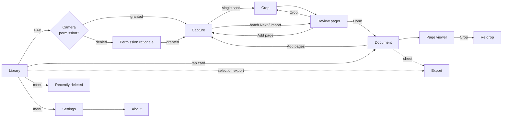

# 06 — Screen Specifications

Each screen lists: requirements covered, layout, UI contract (state / events / effects), behaviour, motion, and restoration. Shared rules from [05](05-ux-design-system.md) apply everywhere and are not repeated.

## Navigation map



---

## 1. Library (launch screen) — FR-1…7, FR-3 search

### Layout

```
┌──────────────────────────────────────┐
│ Deckle                       ⋮       │  large top bar (collapses on scroll)
│ ┌──────────────────────────────────┐ │
│ │ 🔍 Search documents and text     │ │  M3 SearchBar, docks under the bar when collapsed
│ └──────────────────────────────────┘ │
│ [ Date created ▾ ]                   │  sort chip → menu (FR-2)
│ ┌ Continue scanning · 3 pages  → ┐   │  resume banner, only if a staging session exists (02 §5.2)
│ ┌────────┐  ┌────────┐               │
│ │ cover  │  │ cover  │               │  2-col adaptive grid (min 160 dp), FR-1
│ │     ④ │  │    ⑫ │               │  page-count badge
│ └────────┘  └────────┘               │
│ Lease agreement   Receipts Oct       │
│ Today, 14:20      9 Oct              │
│                                      │
│            ( 📷  Scan )              │  ScanFab, bottom-centre (FR-5 one-hand reach)
└──────────────────────────────────────┘
```

### Contract

```kotlin
data class LibraryUiState(
    val content: LibraryContent = LibraryContent.Loading,
    val query: String = "",
    val sort: SortOrder = SortOrder.CREATED_DESC,
    val selection: ImmutableSet<String> = persistentSetOf(),
    val resumableSession: ResumableSessionUi? = null,
    val highlightDocumentId: String? = null,           // glow after "Done" (05 §4.7)
)
sealed interface LibraryContent {
    data object Loading : LibraryContent
    data object Empty : LibraryContent                  // FR-6
    data class NoResults(val query: String) : LibraryContent
    data class Documents(val items: ImmutableList<DocumentCardUi>) : LibraryContent
}
sealed interface LibraryEvent {
    data class QueryChanged(val q: String) : LibraryEvent
    data class SortChanged(val s: SortOrder) : LibraryEvent
    data class CardClicked(val id: String) : LibraryEvent
    data class CardLongPressed(val id: String) : LibraryEvent
    data object ClearSelection : LibraryEvent
    data object DeleteSelected : LibraryEvent
    data object MergeSelected : LibraryEvent
    data object ExportSelected : LibraryEvent
    data object UndoDelete : LibraryEvent
    data object ScanClicked : LibraryEvent
    data object ResumeSession : LibraryEvent
    data object DiscardSession : LibraryEvent
}
```

### Behaviour

- **Search (FR-3):** query debounced 200 ms → `SearchDocumentsUseCase`. Results show the snippet under the title with highlighted terms (`SpanStyle(background = primaryContainer)`). Title matches rank above text matches. Clear (×) restores the grid with `animateItem`.
- **Selection (FR-4):** long-press enters selection; tap toggles; back clears. Top bar becomes `SelectionTopBar`: `✕  3 selected   [Merge] [Export] [Delete]`. Merge enabled for ≥ 2.
- **Merge:** dialog "Combine 3 documents into one?" → `MergeDocumentsUseCase`: new document titled from the first selected, pages appended in selection order (files moved, not copied), sources hard-deleted (they're now empty), all in one transaction. Then navigates to the new document.
- **Delete (FR-7):** soft delete + Undo snackbar.
- **Overflow menu:** Recently deleted · Settings.
- **Empty state (FR-6):** animated paper illustration, "Scan paper into searchable PDFs — all on your phone.", a single filled button "Scan your first document". The FAB is hidden in the empty state so there's exactly one action.

### Motion
FAB → capture container transform. Card → document shared element. Selection badge pop. Empty → first document: illustration fades out, grid fades in with the new card glowing.

### Restoration
`query`, `selection` in `SavedStateHandle`. Sort comes from settings.

---

## 2. Capture — FR-10…18, FR-80

### Layout (portrait; landscape mirrors controls to the right edge)

```
┌──────────────────────────────────────┐
│ ✕          ⚡A      AUTO ◉           │  close · flash (off/on/auto) · auto-capture toggle
│        ( Looking for a page… )       │  HintChip
│                                      │
│      ┌─────────────────────┐         │
│      │  live quad overlay  │         │  full-bleed PreviewView (FR-10)
│      └─────────────────────┘         │
│                                      │
│          Single · Batch              │  ModeToggle (FR-11)
│  🖼          ◯            ▣③        │  import · shutter · thumb stack + count (batch, FR-12)
└──────────────────────────────────────┘
```

### Contract

```kotlin
data class CaptureUiState(
    val sessionId: String,
    val detection: AutoCaptureState = AutoCaptureState.Searching,
    val detectorAvailable: Boolean = true,
    val flash: FlashMode, val autoCapture: Boolean, val batch: Boolean,
    val captureCount: Int = 0, val lastThumbPath: String? = null,
    val zoomRatio: Float = 1f, val focusPoint: Offset? = null,
    val hint: HintUi?,
    val isCapturing: Boolean = false,                 // debounce double taps; never blocks next shot after ~250 ms
)
sealed interface CaptureEvent {
    data class Detection(val quad: Quad?, val timestampMs: Long) : CaptureEvent   // from analyzer
    data object ShutterPressed : CaptureEvent
    data class Captured(val jpeg: ByteArray, val liveQuad: Quad?) : CaptureEvent
    data object CycleFlash : CaptureEvent
    data object ToggleAuto : CaptureEvent
    data class SetBatch(val on: Boolean) : CaptureEvent
    data class Imported(val uris: List<String>) : CaptureEvent
    data object OpenReview : CaptureEvent
    data object Close : CaptureEvent
}
sealed interface CaptureEffect {
    data object TriggerShutter : CaptureEffect                     // auto-capture → the camera layer takes the picture
    data class OpenCrop(val sessionId: String, val captureId: String) : CaptureEffect
    data class OpenReview(val sessionId: String) : CaptureEffect
    data object ConfirmDiscard : CaptureEffect
    data object Exit : CaptureEffect
}
```

The VM never touches CameraX. The camera layer (`CameraController` in the route composable) feeds `Detection`/`Captured` events in and executes `TriggerShutter`. This keeps the VM JVM-testable with a fake clock.

### Behaviour

- **Session:** created on entry (or reused from `CaptureRoute.sessionId` when coming from "Add page" / resume). `targetDocumentId`/`insertAfterPageId` flow from the route into the session.
- **Shutter:** `isCapturing` true for ≤ 250 ms (anti double-fire), haptics and flash per 05 §4.2. Image goes to `ProcessingQueue`; UI never waits on processing (FR-18).
- **Batch (FR-12):** after each shot, preview stays live; thumbnail stack updates when `preview.jpg` is ready. Tapping the stack or a "Next ›" button (appears when count ≥ 1) → Review.
- **Auto-capture (FR-13):** off by default; toggle persisted. Ring per 05 §4.2. Cooldown prevents double capture of the same page.
- **Import (FR-15):** Photo Picker (multi-select, images only). Selected images join the session and → Review.
- **Close with captures:** dialog "Discard 3 scans?" [Keep scanning] [Discard].
- **Permission (FR-17):** route checks permission. Not granted → `CameraPermissionScreen` (illustration, "Deckle needs the camera to scan pages. Photos stay on your phone.", [Allow camera]). If permanently denied (`shouldShowRequestPermissionRationale == false` after a denial), button becomes [Open settings] → `ACTION_APPLICATION_DETAILS_SETTINGS`. A `LifecycleResumeEffect` re-checks on return and swaps to the camera with a fade — **no restart** (acceptance criterion).
- **First run coach marks** (`hasSeenCaptureTips`): two dismissible tooltips — "Hold over a page; edges are found automatically" and "Batch: shoot several pages in a row". Shown once.
- **Degraded:** `detectorAvailable = false` → hint chip text from 05 §4.3; auto-capture toggle hidden.
- **FLAG_SECURE (FR-80):** `SecureWindow(enabled = settings.secureScreens)` effect on this, crop, review, document and viewer screens.

### Restoration
Session id in `SavedStateHandle`; captures come from `ScanSessionStore`. Flash/auto/batch from settings. After process death, the screen reopens with the stack count intact.

---

## 3. Permission rationale
Covered above; standalone composable so it can be UI-tested in isolation (FR-17 test).

---

## 4. Crop editor — FR-20…25 (also used for Re-crop, FR-42)

### Layout

```
┌──────────────────────────────────────┐
│ ◯ loupe                              │  loupe top-left (jumps right when finger is left)
│   ┌──●────────────━━────────●──┐     │  image fitted with 24 dp margin
│   │ ░░ mask outside quad ░░░░  │     │  corner handles ● + mid-edge pills ━
│   ┃                            ┃     │
│   │                            │     │
│   └──●────────────━━────────●──┘     │
│                                      │
│  Retake   ⟲   ⟳   [Full page|Auto]   Next → │  bottom bar; Next is the primary filled button
└──────────────────────────────────────┘
```

### Contract

```kotlin
data class CropUiState(
    val imagePath: String?,                    // preview.jpg (null → show frozen frame)
    val imageAspect: Float,
    val quad: Quad,
    val detectedQuad: Quad?,
    val rotation: Rotation,
    val activeHandle: Handle? = null,
    val rejected: Boolean = false,
    val isFullPage: Boolean,
    val mode: CropMode,                        // NewCapture | Recrop
)
sealed interface CropEvent {
    data class DragStart(val handle: Handle) : CropEvent
    data class DragBy(val handle: Handle, val deltaN: PointN) : CropEvent    // normalised delta
    data object DragEnd : CropEvent
    data class Nudge(val handle: Handle, val dir: Direction) : CropEvent     // accessibility
    data object RotateLeft : CropEvent
    data object RotateRight : CropEvent
    data object ToggleFullPage : CropEvent      // Full page ⇄ Auto (detected)
    data object Retake : CropEvent
    data object Confirm : CropEvent
}
```

### Behaviour

- Handles start at `detectedQuad`, or the image corners if none (FR-23). If the detector found nothing, a small chip says "Edges not found — adjust corners or use full page".
- `DragBy` → `CropConstraint.apply(quad, handle, delta)` keeps points in [0,1] (FR-22) and rejects self-intersecting/concave results; `rejected` drives the error feedback (05 §4.4).
- Rotate (FR-24) rotates the displayed image **and** the quad visually by 90° (animated `graphicsLayer.rotationZ` + scale-to-fit over Medium); the stored quad stays against the unrotated source, rotation tracked separately.
- **Full page ⇄ Auto** toggle animates handles between the image corners and the detected quad (`Handle` spring).
- **Retake (FR-25):** removes the capture from the session, deletes its files, pops to Capture.
- **Next/Confirm:** writes quad + rotation to the session, submits `RENDER`, navigates to Review (new capture) or runs `RecropPageUseCase` and pops (re-crop).
- "Use full page" (FR-23 skip) is the Full page toggle followed by Next — two taps; in batch flow, Review is reachable without ever opening Crop.

### Restoration
`quad`, `rotation`, `isFullPage` in `SavedStateHandle` (as floats) — a half-adjusted crop survives process death.

---

## 5. Review pager — FR-30…34 (D-9)

### Layout

```
┌──────────────────────────────────────┐
│ ←   Page 2 of 3                 ⋯    │  ⋯ = Delete page
│ ┌──────────────────────────────────┐ │
│ │                                  │ │  HorizontalPager over session captures
│ │       dewarped, enhanced page    │ │  pinch-zoom preview
│ │                                  │ │
│ └──────────────────────────────────┘ │
│  [Orig] [Magic] [Colour] [Lighten] … │  FilterStrip (FR-31), live thumbnails, scrolls; 8 modes
│  Apply to all ☐                      │  (batch only, when > 1 page)
│  ✂ Crop   ⟳ Rotate   ☀ Adjust        │
│  ( + Add page )        [ Done ✓ ]    │  FR-34
└──────────────────────────────────────┘
```

### Contract (abridged)

```kotlin
data class ReviewUiState(
    val pages: ImmutableList<ReviewPageUi>,      // id, renderPath (preview), status, mode, adjustments
    val currentIndex: Int,
    val filterThumbs: ImmutableMap<EnhancementMode, String?>,   // for current page
    val applyToAll: Boolean,
    val adjustOpen: Boolean,
    val canFinish: Boolean,                      // all captures READY
    val committing: Boolean,
)
```

### Behaviour

- FR-30/31: selecting a filter calls `PageEnhancer.preview(base, mode, adj, screenLongEdge)` — always from **base** (never from the previous render). Target < 400 ms (FR-32); a thin top progress line appears only after 120 ms.
- FR-33: Adjust opens `AdjustSheet` (brightness, contrast, −100…+100 shown, detent at 0, Reset). Slider drags render previews at a throttled 8 Hz on a 1024 px copy; release renders the full preview.
- Changes are written to the session (mode/adjustments) and a `RENDER` job re-submitted, so commit is quick.
- **Apply to all** (D-10): applies current mode + adjustments to every capture in the session; thumbnails in the pager update with a staggered crossfade.
- Rotate here = rotation on the staged capture → re-render.
- Delete page: removes from session with Undo snackbar.
- **Add page (FR-34):** back to Capture with the same `sessionId` (Capture is already on the back stack in the single flow → `popBackStack(CaptureRoute)`; otherwise navigate).
- **Done (FR-34):** if some captures still processing, the button shows "Finishing 2…" with a small progress ring and enables itself when ready (no blocking dialog). Then `CommitScanSessionUseCase` → navigate to Document with `popUpTo(LibraryRoute)`; library will glow the new card on return.

### Restoration
`currentIndex`, `adjustOpen` in `SavedStateHandle`; everything else from the session store.

---

## 6. Document detail — FR-40…45, FR-50

### Layout

```
┌──────────────────────────────────────┐
│ ←  Lease agreement ✎            ⋮    │  tap title to rename inline (FR-43)
│ 12 pages · Edited today              │
│ ┌──────┐ ┌──────┐ ┌──────┐           │  3-col reorderable grid (FR-40)
│ │  1   │ │  2 ◷ │ │  3 ✓ │           │  OCR badges: ◷ queued, ↻ running, ✓ done (fades), ⚠ failed (FR-44)
│ └──────┘ └──────┘ └──────┘           │
│                                      │
│ ─────────────────────────────────── │
│  ＋Add    ⧉ Copy text   ↗ Share   [ Export PDF ] │  bottom action bar; Export primary
└──────────────────────────────────────┘
```

### Behaviour

- **Reorder (FR-40):** long-press drag (05 §4.6), using `sh.calvin.reorderable` (Apache-2.0, pure Compose, no network). On drop, `ReorderPageUseCase(pageId, newIndex)` persists **immediately** (single row update thanks to sparse indices).
- **Tap page (FR-41):** → Page viewer (shared element).
- **Rename (FR-43):** inline `BasicTextField` replacing the title with an underline animation; IME action Done saves; blank → revert + reject haptic.
- **OCR status (FR-44):** badges per tile; failed badge tap → bottom sheet "Couldn't read text on this page" [Try again].
- **Copy text (FR-45):** `GetDocumentTextUseCase` → clipboard (`ClipData` with `ClipDescription.EXTRA_IS_SENSITIVE = true` on API 33+, since scans may be private) → snackbar "Text copied". If some pages are still processing: "Text copied · 2 pages still being read".
- **Add (FR-34 / FR-42):** opens Capture with `targetDocumentId`.
- **Overflow:** Select pages (multi-select for export of a selection, FR-50; delete), Set as cover (in page long-press menu), Delete document.
- **Share:** shortcut = export PDF with defaults → share sheet.

---

## 7. Page viewer — FR-41, FR-42

Full-screen black `HorizontalPager` over the document's pages; each page is a `ZoomableImage` (pinch 1–5×, double-tap toggles 1× ⇄ 2.5× at the tap point with a spring, pan clamped to bounds; pager swipes only when zoom == 1).

Top: `←  3 / 12`. Bottom action row (FR-42): **Crop** (→ Re-crop; disabled if no source, with explanation), **Filter** (opens a sheet with `FilterStrip` + Adjust, applies via `ReEnhancePageUseCase`), **Rotate** (animated 90° turn, then `RotatePageUseCase`), **Insert after** (→ Capture with `insertAfterPageId`), **Delete** (Undo snackbar; viewer moves to next page with a slide).

Tap toggles chrome visibility (fade, Short) for immersive reading. Restoration: current page id in `SavedStateHandle`.

---

## 8. Export sheet — FR-50…56

`ModalBottomSheet`, opened from Document (all or selected pages) or Library selection (one or more documents → each exported separately as its own PDF, sequentially in one worker).

```
┌──────────────────────────────────────┐
│ Export                               │
│ Format     [ PDF ][ JPG ][ PNG ]     │
│ Pages      ● All 12   ○ Selected 3   │
│ Page size  [ Auto ][ A4 ][ Letter ]  │  PDF only (FR-51)
│ Quality    [ Small ][ Medium ][ Original ]  ≈ 3.4 MB │  FR-52 estimate (animated digits)
│ 🔒 Password protect            ( )   │  PDF only (FR-55) → reveals password + confirm fields
│                                      │
│ [ Save to device ]   [   Share   ]   │
└──────────────────────────────────────┘
```

- Defaults from settings (FR-70). Rows irrelevant to the chosen format collapse with `AnimatedVisibility` (expandVertically).
- **Notifications (FR-56 / permissions):** on the first export on API 33+, request `POST_NOTIFICATIONS` *before* enqueueing, with a one-line rationale inline in the sheet ("Allow notifications to see export progress"). Denial doesn't block export.
- Tapping Share/Save: buttons morph into an inline progress bar "Page 3 of 12"; the sheet can be dismissed — work continues with the notification (FR-56). On success: check-mark draw → share sheet or SAF save.
- Password: two fields, show/hide toggle, mismatch error inline; minimum 4 chars; never persisted (04 §5.2).
- JPEG/PNG (FR-53): Save → `OpenDocumentTree`; Share → `ACTION_SEND_MULTIPLE` of cached files.

---

## 9. Recently deleted — FR-7

List of soft-deleted documents with "Deletes in 23 days" captions. Swipe or select → **Restore** (animates out, snackbar "Restored") or **Delete forever** (confirmation dialog — this one is irreversible). "Empty" action in top bar with confirmation. Empty state: "Nothing here. Deleted documents stay for 30 days."

---

## 10. Settings — FR-70…74, FR-80

Grouped M3 list (`ListItem`s):

| Group | Items |
|---|---|
| Scanning | Default filter · Auto-capture · Default flash · Save originals (subtitle: "Needed to re-crop pages later") |
| Text recognition | Static row: "Reads English and other Latin-script languages" (FR-72: v1 bundles Latin only, so there is nothing to choose) |
| Export | Default quality · Default page size |
| Privacy | Hide scans from screenshots and recent apps (FR-80, default on) |
| Storage | "Documents 412 MB · Cache 38 MB" with a stacked bar (FR-73) · Clear cache (confirm, then the cache figure animates to 0) |
| About | About Deckle → About screen |

### About — FR-74
Shield-and-paper illustration. Headline "Your scans stay on this phone." Body: "Deckle has no internet access — it isn't even allowed to ask for it. There are no accounts, no analytics and no ads. Nothing you scan ever leaves this device unless you share it yourself." Below: version, open-source licences (`OssLicenses`-free: a bundled static `licenses.html` generated at build time by a Gradle task — the Google oss-licenses plugin pulls in Play Services, so it's not used).
